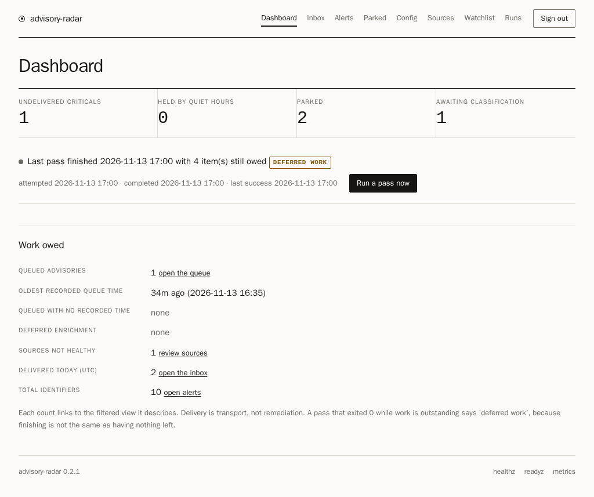
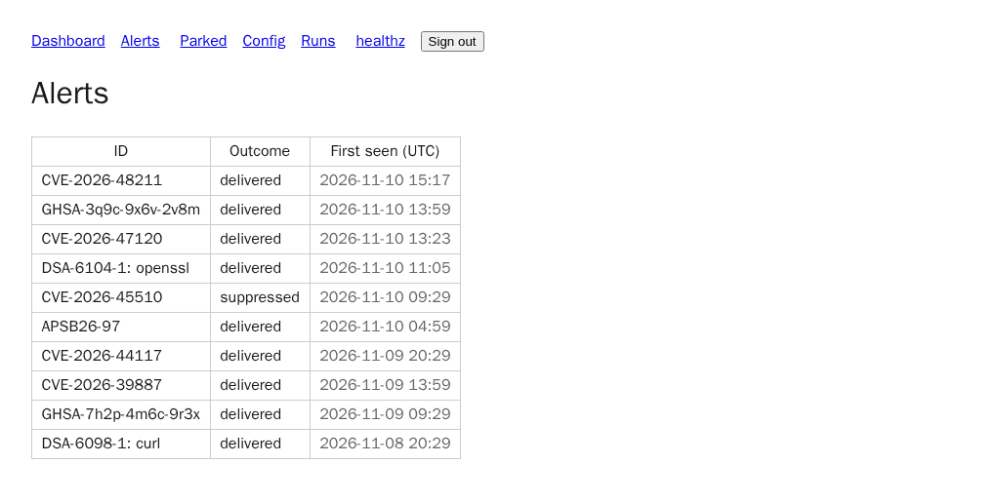
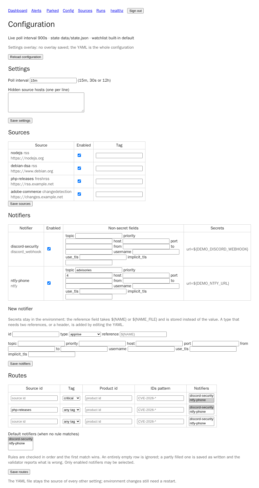
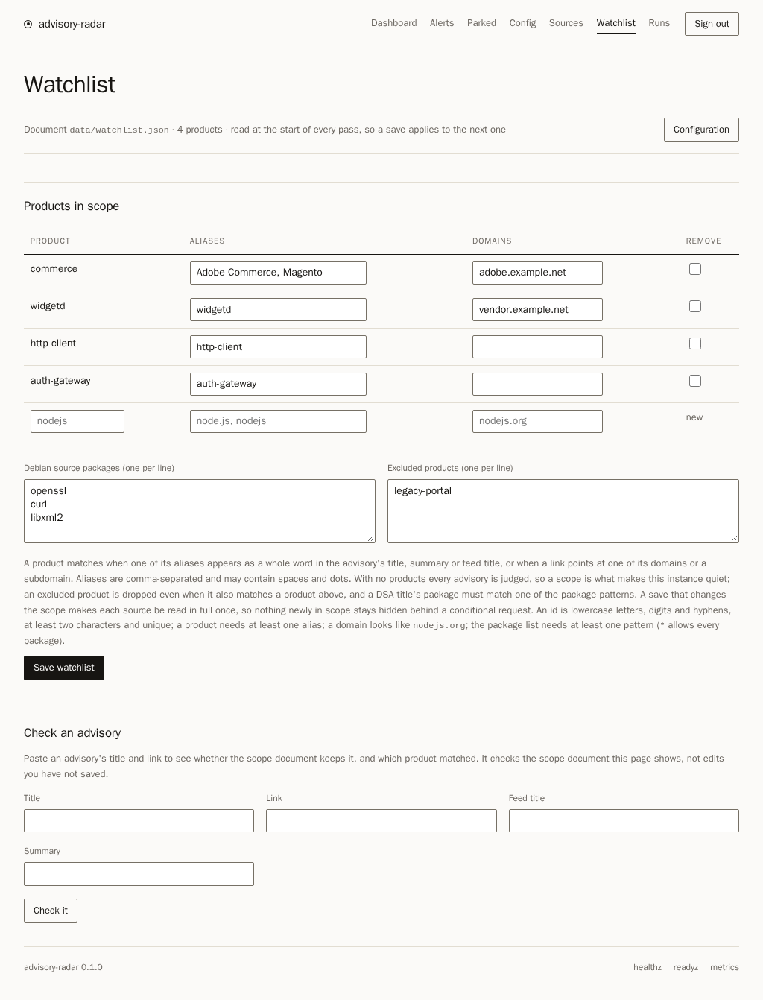
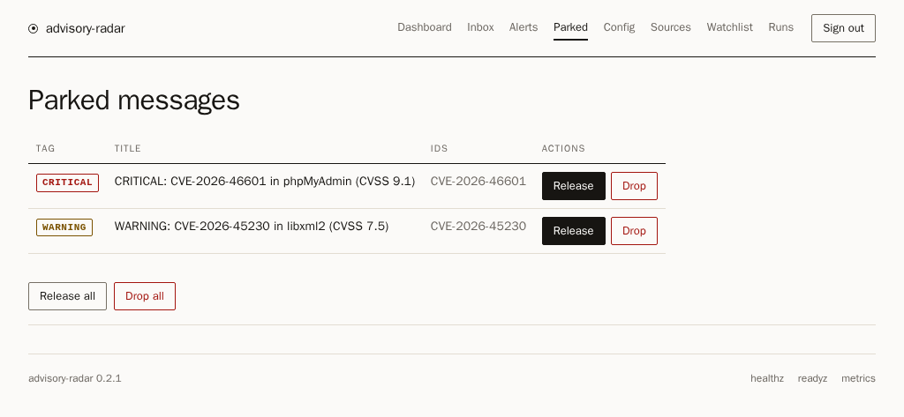
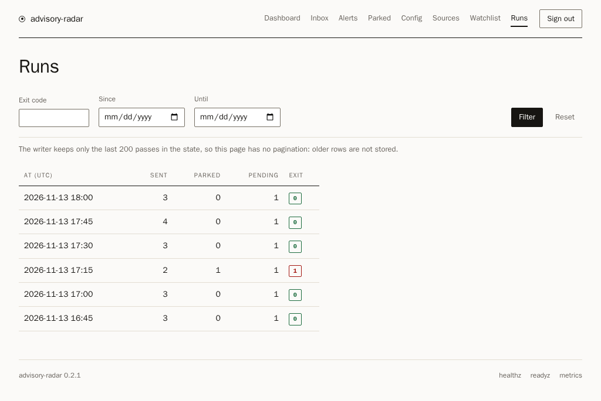

# advisory-radar

Self-hostable security advisory watcher. Point it at the sources you care about
(vendor RSS/Atom/JSON feeds, FreshRSS, changedetection.io, generic webhooks), let it
enrich every finding with CVE.org / NVD CVSS, EPSS, CISA KEV and OSV, decide a
severity per CVE, and deliver one deduplicated alert per new advisory to the
channels you configure (Discord, Matrix, ntfy, Gotify, Apprise, generic webhook,
SMTP). A built-in web UI shows a filterable alert history, a page per advisory,
the parked queue, sources, notifiers and run history. One container, one process,
state on a volume (JSON by default), YAML + environment configuration.

## Quickstart

```bash
# Until the first tagged release is on GHCR, build locally:
docker build -t ghcr.io/mikomiel/advisory-radar:latest .
docker compose up -d
# or with Podman: install deploy/podman/advisory-radar.container as a quadlet
# (see docs/deployment.md)
```

Then open http://localhost:8080 (sign in with `ADVISORY_RADAR_AUTH_TOKEN`) for the
dashboard, alert history and its filters, a page per advisory, the parked queue, run log
and config overview. `/healthz`
and `/metrics` (Prometheus text) are unauthenticated for probes and scrapers.
Configuration lives in `config/` on the mounted volume (see `examples/config.yml`);
secrets come from environment variables or a `${NAME_FILE}` reference to a file, never
from committed files.

```yaml
# examples/config.yml (abridged)
sources:
  - id: nodejs
    type: rss
    url: https://nodejs.org/en/feed/vulnerability.xml
notifiers:
  - id: discord
    type: discord_webhook
    url: ${DISCORD_WEBHOOK_URL}
# optional: scope alerts to what you run (see below); with no key the
# document is watchlist.json beside state_path, and /watchlist edits it
watchlist: /data/watchlist.json
```

`watchlist.json` is optional. Without it every advisory that arrives is judged;
with it, only items that match one of your products (a name alias in the text or
a link on one of its domains) are considered, and `excluded_products` drops the
ones you do not run. Package patterns filter Debian DSA titles.

```json
{
  "schema": "security-watchlist.v1",
  "debian_source_packages": ["curl", "openssl"],
  "excluded_products": ["legacy-app"],
  "products": [{"id": "nodejs", "aliases": ["node.js"], "domains": ["nodejs.org"]}]
}
```

`/watchlist` edits that document in the browser: add a product with its aliases and domains,
edit or remove one, and edit the package patterns and the exclusions. Every list field treats
a repeated entry once, and a save applies to the next pass — the pass reads the policy on
every run, so nothing needs restarting. A save that changes the scope makes each source be
read in full once, because a conditional request would otherwise hide exactly the advisory
that just became in scope.

Where the document lives, in order: the path `watchlist:` names; otherwise
`watchlist.json` beside `state_path` (on `/data`, which is writable — `/config` is
read-only); otherwise the built-in default, which judges everything. `watchlist:` naming a
file that does not exist yet is a configuration error that fails every pass, so a typo can
never silently mean "judge everything"; the page names it and creates it when you save. A
document that is there but cannot be read or even inspected — a broken link, a directory
without the search bit — fails the pass the same way, and the page refuses to edit it. A
save writes nothing when the page is stale (the file changed under it), when a value is
invalid (the rows you typed are re-rendered), or when the destination cannot be written. The
read, the check and the write happen under one lock on the document, so two tabs — or two
processes — cannot silently replace each other's edit. A value one of these fields cannot carry — a
comma inside an alias, or a line break or control character inside an alias or an excluded product —
is rendered read-only with the exact value beside it: the document keeps it, and it is edited in the
file.

To check a rule before relying on it, paste an advisory's title and link into the page's
*Check an advisory* form: it answers in scope or out of scope, names the products that
matched, and is the same match and the same reason the pass uses. It judges the text exactly
as typed — a webhook entry is judged on exactly that text, while a feed normalises its own
titles and summaries first, so a copied title can differ by spacing.

### Risk thresholds

Three numbers decide a level. They can be changed on `/config`, or written in a
`thresholds` block in `config.yml`:

```yaml
thresholds:                 # these are the defaults
  critical_cvss: 9.0        # 0 < x <= 10
  critical_epss: 0.10       # 0 < x <= 1
  suppress_below_cvss: 4.0  # 0 <= x <= critical_cvss
```

- **critical** — the CVE is in the CISA KEV catalog, CISA records active exploitation
  (SSVC), or its CVSS is at or above `critical_cvss` with a remote, unauthenticated,
  no-interaction vector, or with an EPSS score at or above `critical_epss`.
- **suppressed** — every lookup answered, the KEV catalog was readable, and the CVSS is
  below `suppress_below_cvss`. The advisory is recorded and watched; no message is sent.
- **warning** — everything else, an unmeasured severity included: an unknown is never
  suppressed.

A single source may raise or lower the bar for its own items with its own `thresholds`
block. It states only the numbers that differ; the rest are the global block's, key by key,
and the same validation and ranges apply — a refusal names the source whose block it is
(`nodejs: thresholds.critical_cvss must be a number`):

```yaml
sources:
  - id: nodejs
    type: rss
    url: https://nodejs.org/en/feed/vulnerability.xml
    thresholds:
      critical_cvss: 7.0     # this feed's own bar; the other two follow the global block
```

The same block can be saved to the settings overlay from `/config`, key by key, so a feed
you care about more than the rest can be watched more strictly without editing the file. A
source with no block follows the global numbers, and a disabled source's block is not
resolved until the source is enabled.

A message's note names the bar that decided it (`CVSS >= 7.5, remote attack, ...`), so the
text cannot claim a threshold the configuration no longer has. Changing a threshold is a
change of rules, not of the world, so it does not send the backlog out: each watched CVE
records the numbers it was judged under — its source's block when it has one — and the first
evaluation after a change records the new verdict without telling anyone. A change to a
source's block re-baselines only the CVEs that source queued, and a change to the global block
reaches a source only through the numbers that source does not state itself. The entry keeps
what you were actually told
apart from what the numbers now say, so a KEV hit or a CISA active flag that arrives later
still escalates — that is evidence, not a rule.

`/thresholds`, linked from `/config`, previews one advisory: give it a CVSS, an EPSS, its
KEV and SSVC state, a source, a product and the advisory's identifiers, and it shows the
level, the reason, the exact metrics line and note the message would carry, and which route
and notifiers would receive it. It judges the advisory with the previewed source's own block
when it has one, says which numbers it used, and reads the live configuration without writing
anything, so the link can be shared. A route that matches on identifiers needs them: without
one the page says the destination cannot be predicted rather than guessing. A numeric or
`kev` predicate needs the advisory's CVE id for the same reason: the classifier records a
score per CVE it judged, so an advisory-level score is not a measurement a rule can read, and
the page asks for the CVE id instead of inventing one.

### Routing

By default every message goes to every enabled notifier. A `routes` list in `config.yml`
narrows that per message: rules are checked in the order written and the **first match
wins**, so the most specific rule goes first. A rule matches on one or more of:

| Match key | Matches when |
|---|---|
| `source` | the message came from the source with that id; an escalation or an Adobe bulletin has no source, so it never matches a source rule |
| `tag` | the message's severity is exactly that value (`critical` or `warning`) |
| `product` | the item matched that watchlist product id; a message without a product match never matches a product rule |
| `ids` | any id in the message matches the pattern, case-insensitively (`CVE-2026-*`, `GHSA-*`) |
| `min_cvss` | the highest CVSS measured for a CVE the message names is at least this number (`0 < x <= 10`) |
| `epss_gte` | the highest EPSS measured for a CVE the message names is at least this number (`0 < x <= 1`) |
| `kev` | `true` when at least one CVE the message names is in the KEV catalog, `false` when none is |

The three predicates read only what the classification measured, which the queued message
carries: the CVSS and EPSS of every CVE it judged, and its KEV membership. A message with no
measured score never satisfies a numeric predicate — an advisory with no CVE id has an
advisory-level OSV label, not a CVE measurement — and an unmeasured KEV membership, because
the catalog could not be read, satisfies neither `kev: true` nor `kev: false`: the rule
describes evidence the message does not have, and a route chosen for a fact nobody observed
is worse than no rule. An escalation carries the score and EPSS of the CVE it names, so the
predicates apply to it; it still matches no `source` rule.

A `match.tag` outside `critical` and `warning` is refused when the configuration loads: a
message can carry no other tag, so such a rule could never fire. A `match.min_cvss` outside
0..10, a `match.epss_gte` outside 0..1 and a `match.kev` that is not a boolean are refused the
same way — a rule outside the range a score occupies could never fire either. A rule naming a
source id that no source defines still loads — a rule may be staged before its source — and
`/config` reports it as inert until that source exists.

Every key present in one rule must match. `notifiers` names the enabled channels the
message goes to, and `default` is used when no rule matches. Every id must name an
**enabled** notifier in the effective configuration — one the settings overlay adds counts,
one it disables does not — or the configuration is refused when it loads. The `release-parked`
and `drop-parked` recovery commands read the YAML alone and do not enforce that membership:
they need the state path, not a delivery target.

```yaml
routes:
  - match: {source: php-releases}
    notifiers: [matrix-php]       # a source's channel, whatever the severity
  - match: {min_cvss: 9.5, epss_gte: 0.3}
    notifiers: [phone]            # only a score that measured this high reaches the phone
  - match: {tag: critical}
    notifiers: [discord-security]
default: [discord-security]
```

The form refuses a default selection with no rule at all (with no rules every enabled
notifier receives every message). With no `routes` block at all — or an empty list —
nothing changes: every message goes to every enabled notifier. So does a message that matches no rule when no `default` is set
(`default` applies while at least one route is configured). A route that leaves a message
with no notifier is a **failed pass**, not silence: delivery logs the error and the message
stays queued until the configuration is fixed.

The same rules are editable on `/config`: three fixed rows (a source id, a severity tag, a
product id, an ids pattern, a minimum CVSS, a minimum EPSS, a KEV state and the notifiers to
send to) plus a default selection. Saving
replaces the whole block in the overlay, so a form with every row empty keeps the YAML's
rules; a partly filled row is saved as written and the validator reports what is wrong. The
notifier membership is judged once, after the merge, so a rule may select a notifier the
overlay itself adds.

### Delivery: digests, quiet hours and signed webhooks

Two delivery policies live in `config.yml` and on `/config`, and neither changes what a message
contains while it is off. A digest is one message per routing group: entries are grouped by the
notifiers `routing.select` chooses, because two advisories that go to different channels cannot
share a message. The title states how many advisories it covers, the body lists one line per
advisory (its title, plus up to three short identifiers), and the digest is tagged `critical`
when any covered advisory is critical. It lists at most 20 advisories and never exceeds the
character budget one Discord message accepts; anything beyond either cap is counted in a final
`(+N more not listed)` line rather than dropped. A digest is posted once per destination, so a
failed attempt counts once against every advisory it covered, and delivery records each of them
separately; a destination that already accepted an advisory is not sent it again, and a digest
rebuilt after a partial acknowledgement carries only the advisories that destination still needs.

```yaml
digest: true                 # one message per routing group instead of one per advisory
quiet_hours: 22:00-07:00     # local time, wraps midnight; empty or absent means off
```

`quiet_hours` holds **non-critical** messages until the window ends: they stay in `pending`,
are not counted as failed attempts, and go out on the first pass after the window. A critical
message is never held, and a held message does not take one of the pass's delivery slots, so a
queue of them cannot push a critical advisory behind it. The window is half-open, so `07:00` is already outside
`22:00-07:00`; `00:00-00:00` is an empty window. It is read in the process's local timezone, so
set `TZ` on the container if the service should not run in UTC. Both keys are overlay-writable,
so the Settings form on `/config` changes them without a restart.

A generic `webhook` notifier may carry a signing secret, referenced from the environment:

```yaml
notifiers:
  - id: hooks
    type: webhook
    url: ${WEBHOOK_URL}
    secret: ${WEBHOOK_SIGNING_SECRET}
```

With a secret set, every request carries two headers:

| Header | Value |
|---|---|
| `X-ADR-Timestamp` | the Unix time the request was signed, in decimal seconds |
| `X-ADR-Signature` | `sha256=` followed by the lowercase hex HMAC-SHA256 of `timestamp + "." + body`, keyed with the secret |

`body` is the exact byte string posted — the JSON is serialised once — never a re-serialisation
of it. A receiver verifies a request by parsing the timestamp, refusing one more than 300
seconds from its own clock, reading the raw body bytes, recomputing
`hmac.new(secret.encode("utf-8"), timestamp.encode("ascii") + b"." + body, hashlib.sha256).hexdigest()`
and comparing `"sha256=" + digest` with the header using `hmac.compare_digest`; a plain `==`
would leak timing information. With no secret, no signature headers are sent and the request is
byte-for-byte the one earlier versions sent.

### Advisories, filters and the queue

`/alerts` filters the seen advisories by severity tag, recorded source, outcome, a
case-insensitive text search (identifier and title) and an inclusive UTC day range. Every
filter lives in the URL query string, so a reload or a shared link keeps it. The list is
paged with a keyset cursor (50 rows, newest first by time then identifier) instead of a
fixed cap, and each row links to the advisory's page (the identifier is encoded in the path,
so a stored GUID or URL containing slashes still opens). An advisory's identity is kept
exactly as the publisher sent it — only its log and display spelling is escaped — because
transforming an identity can merge two advisories into one. `/advisories/<id>` shows the stored
classification — tag, source, title, the identifiers and CVEs, whether any was KEV-only,
the watchlist products the item matched, the per-CVE levels and CVSS, and the notifiers
that accepted the message — for a delivered message, a pending one or a parked one. It never
renders the message body: a delivered record does not retain it, and a pending or parked
queue entry still carries its own body only until it leaves the queue. The record is stored
once per delivered message and each identifier points at it, so an advisory that names
thousands of identifiers does not multiply it. A record written by an older version says its
details were not recorded instead of inventing them. `/parked` releases or drops a
single message per row while keeping the bulk actions, and `/runs` filters by exit code and
day; the writer keeps only the last 200 passes, so that page states the cap rather than
paging.

### Settings without a restart

The `/config` page changes ten things without editing the YAML or restarting the
container: `notifiers`, each source's `enabled` flag, watch `tag`, threshold block and poll
`interval`, the sources the overlay itself adds, `poll_interval`, `hidden_source_hosts`, the routing
`routes`/`default` block, the risk thresholds, the delivery `digest` switch and its `quiet_hours`
window. The notifier form manages the whole list — that is how a channel is added, edited or
disabled — and while the overlay holds a notifier list, that list
replaces the YAML's membership and ordinary fields; a notifier's `headers` stay in the YAML
and a `secret` may stay there too, both carried over by id — the overlay may not store a
header mapping, and it stores a signing secret only as a reference. A notifier added to the
YAML while the overlay holds a list is not used until that section is removed from the
overlay. Sources work the other way round:
the YAML owns the list and the overlay may only **add** to it, so a source added on
`/config` needs no edit to a read-only config mount while a YAML edit never loses to an
older overlay. The two may not share an id — the overlay refuses one the YAML already
defines, so which URL is polled is never decided by merge order. A save writes
`settings.json` next to `state_path` (on the `/data` volume); it is not part of the state
document, whatever store holds that. The save applies immediately when the state lock is free; if a pass holds the lock, the
page says the revision is not live yet, and Reload applies it when the pass finishes. Each
form carries a fingerprint of the configuration it was rendered from, so a second tab —
after another save, a YAML edit, or the overlay being deleted and recreated — is refused
with `409` instead of overwriting rows it never saw.
`SIGHUP` re-reads `config.yml` and the overlay, for a configuration edited by hand. Every
other setting stays in `config/config.yml`; editing most of it needs a reload (the button
or `SIGHUP`), not a restart — `web.host`, `web.port`, `state_path` and `storage` are bound when the
process starts, and a change to one of them needs a restart.

Secrets stay in the environment. The overlay stores a notifier's `url`, `key`,
`password`, `token` or signing `secret` only as a `${NAME}` or `${NAME_FILE}` reference,
refuses a literal value, and does not accept `headers` at all. Changing an environment
variable still needs a restart, because the process reads the environment when it starts.

A reload builds the new configuration and its plugins before it swaps them in under the
state lock. A shared configuration value goes through the same validator the YAML does,
and the overlay adds its own restrictions (a notifier's secret must be a reference, a
source the YAML defines may only be re-flagged and re-tagged there, a source the overlay
adds must be a complete entry with a literal id and must carry a recognised secret as a
reference — a URL is ordinary configuration, so a URL that embeds a token has to be written
as one, and nothing can tell whether it was — `headers` may not be written), so a refused
overlay is reported with
the validator's message; the running configuration stays; a pass that already started finishes with the
configuration it started with, and the next pass uses the reloaded one. The wait between
passes follows the live interval, so shortening `poll_interval` takes effect without sleeping
out the old one. A reload re-reads both files; it refuses `web.host`, `web.port`, `state_path` and `storage` rather than report them
applied, because they are bound when the process starts. Environment variables are read at
start too, so changing one still needs a restart. Deleting `settings.json` and reloading
returns to the YAML: the empty overlay is applied as revision 0.

### Storage

`state_path` is a single JSON document by default, and the `storage:` key moves those bytes
without changing the document model, the pages or the commands. `sqlite:////data/state.db`
keeps one file for one host (WAL, `synchronous=FULL`, mode `0600`); `postgresql://` shares
one document between instances and needs the optional driver
(`python -m pip install 'psycopg[binary]'`). The YAML owns the key: the overlay cannot move
the store, and a reload refuses a changed `storage:` exactly as it refuses a changed
`state_path`. `settings.json` and the KEV cache stay beside `state_path`; neither is part of
the document.

`advisory-radar migrate --config config/config.yml --to sqlite:////data/state.db` copies the
document read through the configured store into another one, and prints both stores — never
the URL, which can carry a password. It refuses a target that already holds a document, so a
wrong `--to` cannot overwrite a live state, and it leaves the source in place: set `storage:`
to the new store and restart once the copy looks right.

### Gap detection

A source that knows its own page size (a FreshRSS export) reports a truncated
window, and the pass fails loudly when a full window shares nothing with the
previous one — that is how silently missed advisories surface. An `rss` source is
bounded by its publisher, and the changedetection.io source reports no
truncation at all, so a skipped item there cannot be detected; poll those sources
often enough that rotation is unlikely.

## Why

Vendor security feeds are noisy; the interesting question is "does this affect
what I run, and how badly". advisory-radar answers it per CVE (CVSS, EPSS,
KEV, SSVC), suppresses the noise below the floor, escalates when a watched CVE
turns critical, and never re-sends what you already received.

## Features

- Configurable source plugins: RSS/Atom/JSON Feed, FreshRSS (GReader API), changedetection.io (API poll + inbound webhook), generic inbound webhook; vendor enrichment for Debian DSA, php.net ChangeLog, Node.js security blog, Adobe APSB bulletins
- Enrichment plugins: CVE.org, NVD, FIRST EPSS, CISA KEV, OSV, Debian security tracker
- Notifier plugins: Discord webhook, Matrix (Hookshot), ntfy, Gotify, Apprise, generic webhook
  (optionally signed), SMTP; digests per routing group and local quiet hours for non-critical
  messages
- Severity decision per CVE with re-evaluation window and one escalation per level; the
  thresholds are configurable on `/config` globally or per source, and `/thresholds` previews
  what one advisory would be judged as and where its message would go
- Filterable `/alerts` and `/runs` lists with their state in the URL, keyset pagination for
  the alert history, and a per-advisory page (`/advisories/<id>`) showing the stored
  classification and delivery record
- Web UI + REST API, in-process scheduler (default every 15 min), atomic state on a volume:
  a JSON file by default, SQLite or PostgreSQL when `storage` says so
- Per-entry release/drop on the parked queue, next to the bulk actions; `routes`/`default`
  editable on `/config` with the other settings
- Docker and Podman deployment (compose file + quadlet/kube YAML), `/healthz` and `/metrics`
- Secrets via environment / `${NAME_FILE}` references only; redaction filter on logs; fail-closed source errors

## Screenshots

The UI is server-rendered: there is no JavaScript build step. Its pages share one
hand-written stylesheet with no script, no web font and no external origin, and it follows
the reader's light or dark preference. These are from a local run with demo data, so the
advisories in them are not real findings. The set is
reproducible: `uv run --with playwright python scripts/capture_screenshots.py` builds the
demo config and state in a temporary directory, serves the app on loopback and writes the
six PNGs (Playwright is opt-in and not a project dependency; see
`docs/deployment.md`).



| Alerts | Configuration |
|---|---|
|  |  |

| Watchlist | Parked messages |
|---|---|
|  |  |

| Runs |
|---|
|  |

## Sources

Four source types are built in, and the table below is the whole catalogue: a
**required** key has no default, an **optional** one may be left out. The same
catalogue is on the `/sources` page of the web UI and in
`advisory-radar sources list`, which needs no config file.

`advisory-radar sources test <id>` fetches one *configured* source, prints its
items and whether its window was truncated, and exits non-zero when it was or
when the fetch failed. It sends no notification and writes no state, so it is
safe to run while the service is polling. A `webhook` source is read from an
empty inbox, so it prints no items: the command checks configuration, not intake.

The same probe is a button. `/config` can add a source without touching the file:
pick a type, fill the keys it declares, and press **Test the new source** — the
probe performs the fetch a pass performs, shows the entry count, the first entries
or the error, and writes nothing. A probe of an unsaved source reports a missing
`${NAME}` by name, never its value, and offers to save the source it just fetched.
Every configured row has its own **Test** button, and `/sources` shows one health
line per enabled source — the last attempt, the last success, the entries in that
window and the error that attempt reported — with the same numbers exported as
metrics (see `docs/deployment.md`).

An `rss` source is one URL and needs no format key. RSS 2.0, Atom, RSS 1.0 (RDF) and
JSON Feed are recognised from the document itself, and JSON Feed is told apart from the
FreshRSS GReader export by its `version` URL rather than by having an items list. A URL
that answers an HTML page instead is followed through that page's
`<link rel="alternate">` autodiscovery exactly once; the page is not crawled, and no
validator is stored for it, because a page's `ETag` says nothing about the feed behind
it. Conditional GET still applies to a feed that answers directly. The advertised feed
is held to two rules, both checked **before** it is fetched and neither relaxed by
`allow_private_sources`: it must share the page's own origin — the same scheme, host and
port — and it must not resolve to a loopback or private address. The first is the
containment: the page's own host is the one the operator already chose, so discovery
cannot redirect the reader to a host an attacker picked, and a feed genuinely served from
another host is configured directly. The second keeps the existing guard rail against a
router page or the metadata service, because the page — not the operator — chose that URL.

Every source may carry `interval: 30m` (the same `<n><s|m|h>` spelling as
`poll_interval`) to be fetched at its own pace; without one it follows the global
interval. The interval throttles the fetch only: re-evaluation, escalation and delivery
still run for every source on every pass, so a slow feed never delays an alert. A fetch
that fails is retried on the next pass instead of waiting out the interval, so one
transient error cannot become an outage. `interval` is accepted by every kind in
addition to the keys in the table.

A pasted OPML 2.0 subscription list is imported with **Add feeds from OPML** in the same
section: every `<outline>` with an `xmlUrl` becomes an `rss` source, folders are
descended into, and a feed already configured or repeated in the document is skipped and
counted. Each URL is checked exactly as a single add is, and a document that cannot be
read, holds no feed, or names one unusable address is refused without writing anything.
The outline title is not stored: the existing URL-host id derivation and the watch tag
keep the meanings they already have.

A source added on that page may not point into a private network: the form refuses
an address that resolves to loopback or to an internal range, unless the YAML sets
`allow_private_sources: true`. A configured YAML source is never subject to the
check, so a FreshRSS or changedetection.io instance on the LAN stays a supported
target, and a probe of a source the page added is judged whether or not that source
is enabled — switching it off is allowed without the check, probing it is not.

That check is a guard rail against pointing this instance at a router page by
mistake, not an isolation boundary. The pass resolves the name again when it
fetches, so a name whose answer changes is followed, and the UI token is a
full-trust credential besides: it can read every advisory, rewrite every
notification target and run a pass. Anyone who must not reach the internal network
must not hold it, and the isolation that does hold is a network one: run the
container where it has no route to what it must not reach.

Every origin the two pages show — a probe's answer and a configured source on
`/sources` — every title a probe shows, and every id are all restricted: the origins
and titles are redacted against the secrets the configuration resolved, and an id is
a name. The validator refuses a whole `${NAME}` reference in one, and refuses an id
composed from a variable that supplies a credential anywhere in the same
configuration (`id: feed-${CD_TOKEN}` beside `api_key: ${CD_TOKEN}`, or beside
`url: …?token=${CD_TOKEN}`), because an id
appears in routes, logs, the state and — for a source — a metric label on the
unauthenticated `/metrics` endpoint. A name composed from a naming variable
(`tenant-${X}`) stays allowed, and the value it composes is what those places show.
An id the overlay adds must be literal text, since there is no file to read it
from.

| Kind | Summary | Required keys | Optional keys |
|---|---|---|---|
| `rss` | Any RSS 2.0, Atom, RSS 1.0 or JSON Feed URL, or a page that advertises one, read in one conditional GET. | `url` | `tag`, `enabled` |
| `freshrss` | A FreshRSS shared query, read through its GReader JSON export. | `url`, `token` | `user`, `enabled` |
| `changedetection` | Poll a changedetection.io instance; every watch whose page changed becomes one item. | `url`, `api_key` | `tag`, `enabled` |
| `webhook` | Items pushed to this instance's `/webhooks/<id>` endpoint, read from the state inbox. | — | `tag`, `enabled` |

An accepted key is not always read by every kind: `tag` scopes a
changedetection.io poll to one watch tag and the other kinds ignore it, so the
column is only meaningful there; `user` names the FreshRSS account; `interval`
thins that source's polling; and `enabled: false` keeps an entry in the file
without building it. An RSS/Atom/JSON Feed and a changedetection.io poll return
the whole response, so the FreshRSS GReader export is the only built-in that
reports a truncated window.

## Review and merge

`main` requires CI and a review at the exact head: `ci`, `gate` and `review` must
be green, and `dependency-review` blocks a pull request that introduces a
vulnerable dependency. Changes to workflows, `scripts/`, `tests/` or packaging
are merged by a person; ordinary changes may be merged by the repository's own
automation after the approval, and Dependabot manifest updates need no App
approval. Status semantics, the sensitive-path guard and the `allow_auto_merge`
caveat are in [docs/review-and-merge.md](docs/review-and-merge.md).

## Development

```bash
uv sync --group dev
uv run ruff check .
uv run pytest -q
uv run python -m advisory_radar --help
```

Conventional Commits; every PR runs lint, tests, a secret scan and a
no-internal-identifiers scan on free GitHub-hosted runners; `main` is protected
(requires green CI and a review).

## Security

Report vulnerabilities privately via GitHub's private vulnerability reporting
(see [SECURITY.md](SECURITY.md)). Do not open public issues for undisclosed
vulnerabilities.

## License

[MIT](LICENSE)

## Status

`0.1.0` — the first public release. The pipeline, plugin seams, web UI, container
and integrations are complete and covered by the test suite that CI runs on every pull
request on free GitHub-hosted runners. Version numbers follow SemVer; every `vX.Y.Z` tag
on `main` publishes a multi-arch image to `ghcr.io/mikomiel/advisory-radar`, with build
provenance and an SBOM attestation bound to the pushed digest:

```
gh attestation verify oci://ghcr.io/mikomiel/advisory-radar:<tag> --repo mikomiel/advisory-radar
```

What is deliberately not here yet: a per-host agent, alert deduplication across
sources beyond the watch window, and any hosted service. Issues and pull requests
are welcome.
