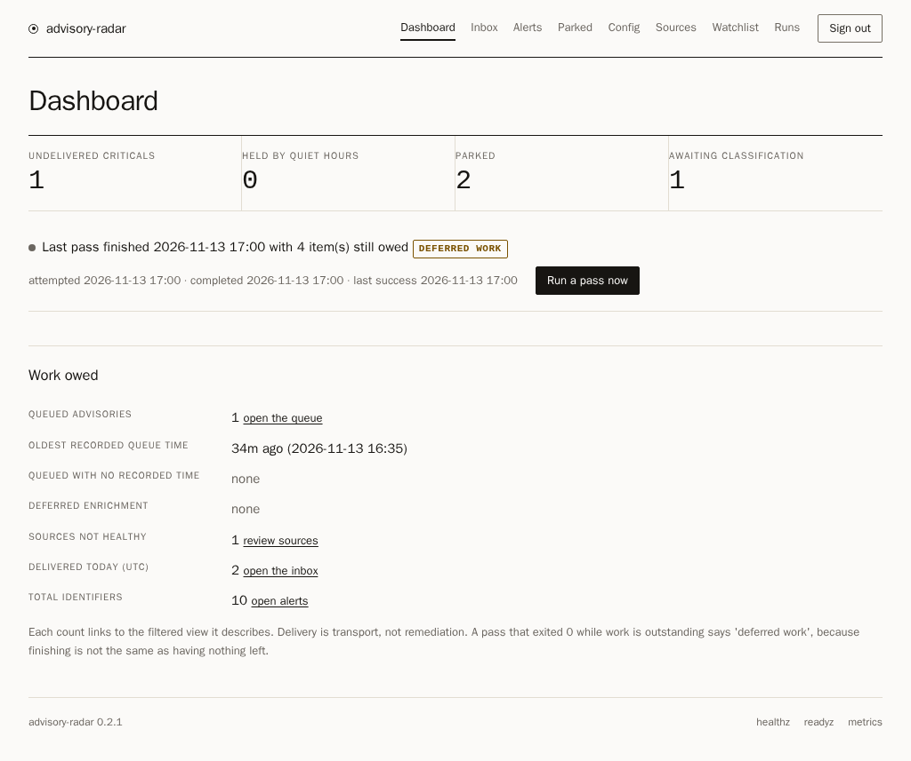

# advisory-radar

Self-hostable security advisory watcher: it reads the vendor feeds, webhooks
and changedetection.io watches you configure, enriches every finding with
CVE.org / NVD, EPSS, CISA KEV and OSV, decides a severity per CVE, and sends one
deduplicated alert per new advisory to the channels you choose.



## What it does

- Watches RSS/Atom/JSON Feed, FreshRSS, changedetection.io and inbound webhooks,
  with vendor parsing for Debian DSA, php.net, Node.js and Adobe bulletins.
- Enriches each advisory with CVE.org, NVD, EPSS, CISA KEV, OSV and the Debian
  tracker, re-evaluates it inside the window and escalates once per level.
- Judges a level per CVE — critical, warning or suppressed — from global and
  per-source thresholds; an unmeasured severity is never suppressed.
- Delivers to Discord, Matrix, ntfy, Gotify, Apprise, signed generic webhooks
  and SMTP, with routing groups, digests and quiet hours for non-critical mail.
- Serves a server-rendered UI and REST API: alert history with URL filters, a
  page per advisory, the parked queue, sources, notifiers and run history.
- Keeps state in one JSON document, SQLite or PostgreSQL; `/healthz` and
  `/metrics` are unauthenticated for probes and scrapers.

## Quickstart

Create the configuration directory and the login token, then start it:

```bash
mkdir -p config
cp examples/config.yml config/config.yml   # then edit the sources; its one notifier ships disabled
printf 'ADVISORY_RADAR_AUTH_TOKEN=%s\n' "$(openssl rand -hex 24)" > .env
chmod 600 .env
docker compose up -d --wait
```

A fresh copy starts with only that token: the example's notifier (`discord`) is disabled,
so nothing is sent until you enable one. To deliver alerts, add its variable to `.env`
(`DISCORD_WEBHOOK_URL=...`), delete `enabled: false` from that entry in `config/config.yml`
and run `docker compose up -d` again. `--wait` returns once the container reports healthy;
if it does not, `docker compose logs advisory-radar` says why.

`docker compose up -d` pulls `ghcr.io/mikomiel/advisory-radar:latest`, which the
`v*.*.*` tag workflow publishes ([Status](#status); `0.1.0` was the first public
release). The compose file and the Podman quadlet need an image that has the `healthcheck`
command and a `/data` owned by the image's user, which releases up to 0.3.1 lack: use a
later release, or build this checkout first with
`docker build -t ghcr.io/mikomiel/advisory-radar:latest .`. To follow one release instead of
`latest`, set `ADVISORY_RADAR_TAG=vX.Y.Z` in `.env`
([image tags](docs/deployment.md#image-tags-updates-and-rollback)).

Open http://localhost:8080 and sign in with the token in `.env`. The compose file
publishes the port on the loopback address only. The session cookie is `Secure` by
default, so a plain-HTTP trial needs `ADVISORY_RADAR_INSECURE_COOKIES=1` in `.env`, and an
instance you keep running needs TLS terminated in front of it
(see [exposing the web UI](docs/deployment.md#exposing-the-web-ui)).

Configuration is `config/config.yml` on the read-only `/config` mount, and state
lives in the `advisory-radar-data` volume, which is `/data` in the container
([a directory works too](docs/deployment.md#state-in-a-directory-instead-of-a-volume));
start from [examples/config.yml](examples/config.yml) and read
[docs/configuration.md](docs/configuration.md). Secrets come from environment
variables or a `${NAME_FILE}` reference to a file, never from committed files.
[docs/deployment.md](docs/deployment.md) is the canonical deployment procedure,
including Podman (the quadlet at `deploy/podman/advisory-radar.container`) and
Kubernetes.

## Documentation

- [Configuration](docs/configuration.md) — watchlist, thresholds, routing,
  delivery, settings, storage and gap detection.
- [Sources](docs/sources.md) — the source catalogue, probe behaviour, intervals
  and OPML import.
- [Notifiers](docs/notifiers.md) - the notifier catalogue, the settings form and
  the test message.
- [Deployment](docs/deployment.md) — compose, Podman, health and metrics.
- [Features](docs/features.md) — the full capability list and the problem it
  solves.
- [Screenshots](docs/screenshots.md) — the UI gallery.
- [Review and merge](docs/review-and-merge.md) — the automation and its limits.

## Contributing

Bug reports and pull requests are welcome. `main` requires exact-head CI and
review; the contributor workflow, the sensitive paths and the merge rules are in
[CONTRIBUTING.md](CONTRIBUTING.md) and
[docs/review-and-merge.md](docs/review-and-merge.md).

## Development

```bash
uv sync --group dev
uv run ruff check .
uv run pytest -q
uv run python -m advisory_radar --help
```

Python 3.13 and 3.14 are supported and tested; the range is declared in `pyproject.toml`.

Conventional Commits; every PR runs lint, tests, a secret scan, a
no-internal-identifiers scan and an end-to-end start of the Compose and Podman
deployments on free GitHub-hosted runners; `main` is protected (requires green
CI and a review).

## Security

Report vulnerabilities privately via GitHub's private vulnerability reporting
(see [SECURITY.md](SECURITY.md)). Do not open public issues for undisclosed
vulnerabilities.

## License

[MIT](LICENSE)

## Status

`0.1.0` was the first public release. Version numbers follow SemVer. Releases
are prepared by [Release Please](https://github.com/googleapis/release-please)
from the conventional commits merged to `main`: merging its release pull request
creates the `vX.Y.Z` tag, and the tag publishes a multi-arch image to
`ghcr.io/mikomiel/advisory-radar`, with build provenance and an SBOM attestation
bound to the pushed digest:

```bash
gh attestation verify oci://ghcr.io/mikomiel/advisory-radar:<tag> --repo mikomiel/advisory-radar
```

Deliberately not here yet: a per-host agent, cross-source deduplication beyond
the watch window, and a hosted service.
