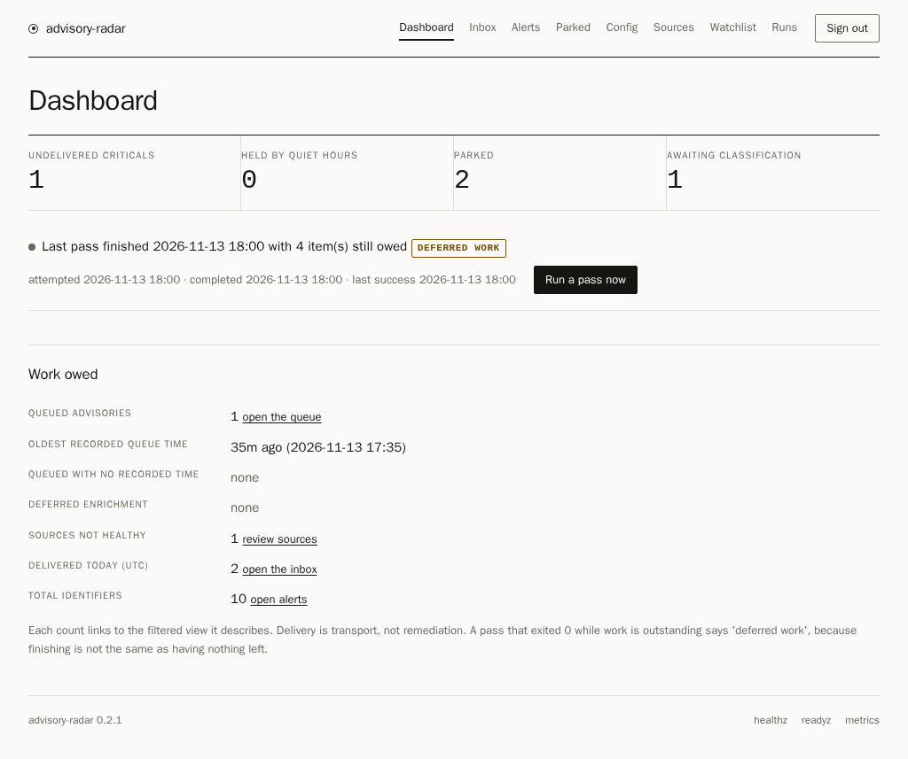
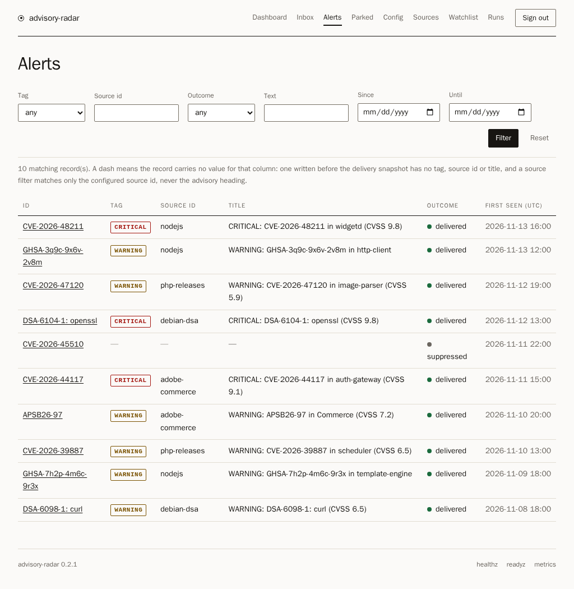
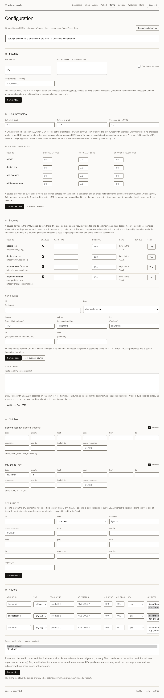
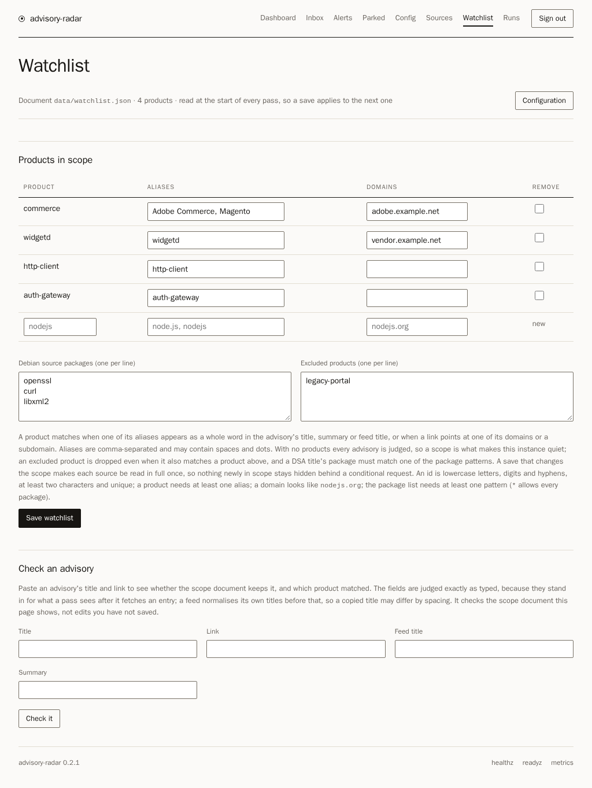
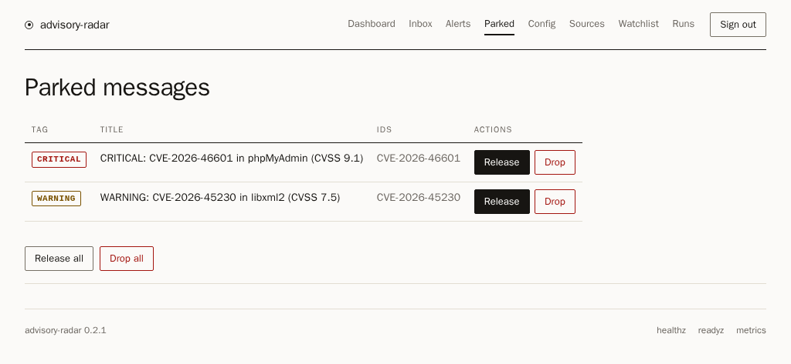
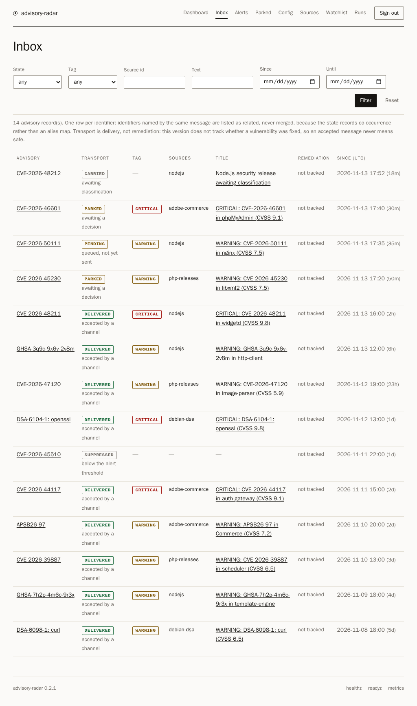
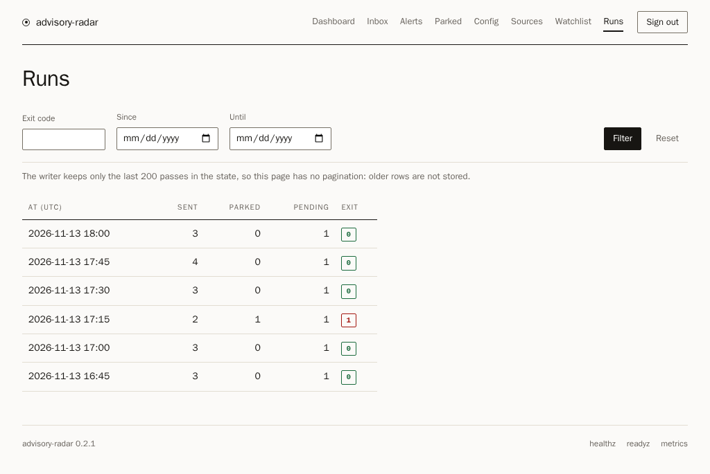

# Screenshots
The UI is server-rendered: there is no JavaScript build step. Its pages share one
hand-written stylesheet with no script, no web font and no external origin, and it follows
the reader's light or dark preference. These are from a local run with demo data, so the
advisories in them are not real findings. The set is
reproducible: `uv run --with playwright python scripts/capture_screenshots.py` builds the
demo config and state in a temporary directory, serves the app on loopback and writes the
seven PNGs (Playwright is opt-in and not a project dependency; see
`deployment.md`).

| Alerts | Configuration |
|---|---|
|  |  |

| Watchlist | Parked messages |
|---|---|
|  |  |

| Inbox | Runs |
|---|---|
|  |  |

